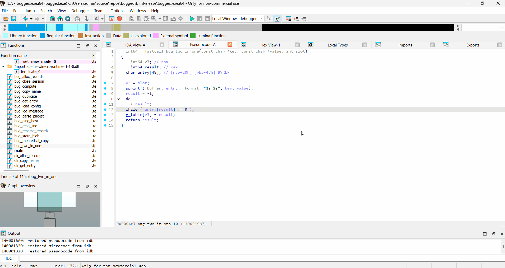
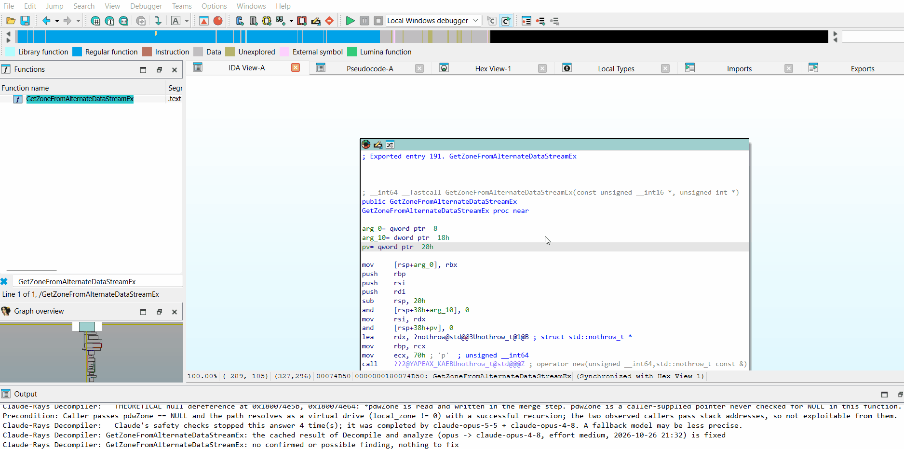
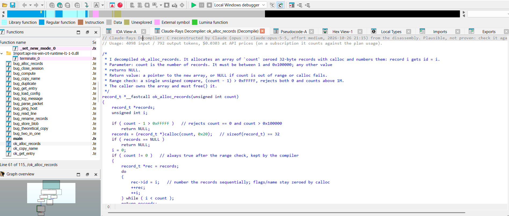
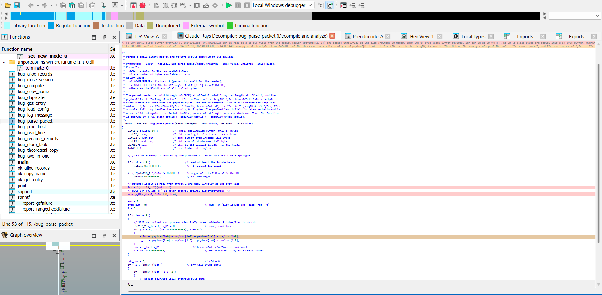
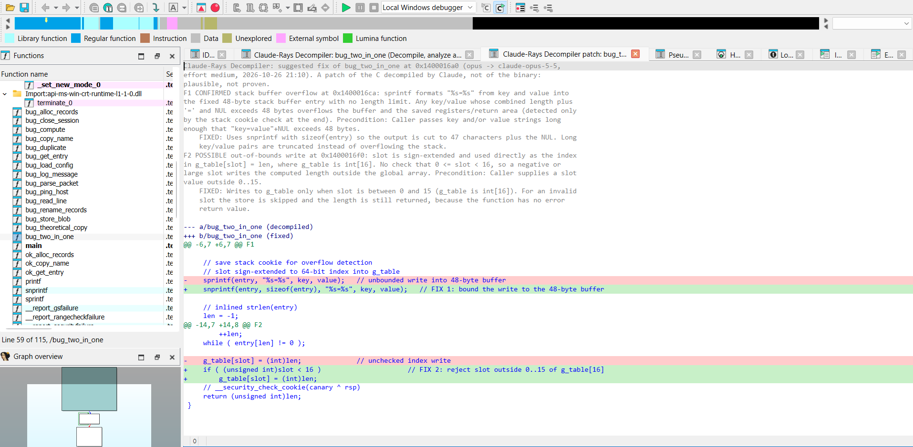

# Claude-Rays Decompiler for IDA Free/Pro

**Decompile, analyze and patch a function with Claude, working from the disassembly.** A native plugin for IDA Free/Pro 9.4+: it needs neither Hex-Rays nor IDAPython, so it gives IDA Free readable C, a security review and suggested fixes for any x86/x64 function.



> **Note:** So far the plugin has only been tested on Windows, with IDA Free 9.4 and x86/x64 binaries. It is a native plugin built with the current SDK, so it should work in IDA Pro too.

It has a Ghidra sibling, [Claude-Rays Decompiler for Ghidra](https://github.com/Claude-Rays/claude-rays-decompiler-ghidra), with the same prompts, validation and cache, and it is the engine behind *Claude diff pseudo-code* in [Diaphora-ng for IDA Free/Pro](https://github.com/Claude-Rays/diaphora-ng-idafree).

## Motivation

The idea came while designing an IDA Free version of [aidapal](https://github.com/atredispartners/aidapal), the plugin by Atredis Partners that sends the decompiled code of a function to a local model trained for the task and gets back a name, a comment and variable names. That was two years ago, with a model trained for one job. Why not use what Claude can do today instead, and go one step further: let it write the C itself, from the disassembly, in an IDA Free that has no decompiler a plugin can use?

It is also the opposite of the MCP servers for IDA, such as [ida-free-mcp](https://github.com/0xshlomil/ida-free-mcp). Those connect IDA to Claude: Claude drives IDA through tools and decides what to look at. Claude-Rays Decompiler connects Claude to IDA: the plugin collects the context of one function deterministically, asks Claude for one thing (decompile, analyze or patch it), validates the answer against the database and shows it in an IDA view, like a decompiler would.

### What you give up

- **The reverser's own work.** In IDA, understanding a function usually means renaming functions, variables and structures, retyping and commenting until the code reads well, and IDA keeps all of it. Here Claude does that step in one go: you get higher-level code, with the names, types and structures the model chose, instead of building them yourself.
- **The view is read-only.** You cannot rename or retype in it. You can still follow the code: a double-click on a callee opens its own view, Shift+double-click and a double-click on a line jump to the disassembly. What you rename or retype in the database is part of the context of the next query; a cached result whose callees were renamed is marked `STALE`, and *Regenerate* picks up the new names. The only thing the plugin writes back is the summary, as the function comment, when you ask for it.

### Not an act of faith

- The output is **plausible, not proven**. Claude reconstructs the C from the disassembly; the validator checks calls, basic blocks and addresses against the database, not the semantics. Treat the code as a strong hypothesis to confirm in the listing, especially on hostile binaries, which can also try to mislead the model.
- The **security review** sees one function: bugs that depend on the callers mostly stay out of reach, and a result with no findings does not mean the function is safe.
- The **fixes** are a patch of the decompiled C, a suggestion to read, not a patch of the binary.
- The disassembly and the names in the database **leave your machine** (see [Privacy and cost](#privacy-and-cost)).

## What it does

- **Decompile.** The plugin collects the function's context from the database (an annotated listing by basic block, the stack frame, callees, call sites, data and types) and asks Claude, through the [Claude Code](https://claude.com/claude-code) CLI, for the C. The answer opens in a colored, navigable view, like a Hex-Rays pseudocode window.
- **Validate.** The model tags every statement with the address of its first instruction (`/*0x401020*/`). The plugin checks those addresses against the database: missing calls, basic blocks without code and addresses outside the function become warnings in the header of the view. The same addresses let you jump from any line to the listing. The view hides them by default.
- **Decompile and analyze.** The same query also asks for a security review: each finding has a level (*confirmed*, *possible*, *theoretical*), a class, the instructions of the bug and the precondition it needs. Findings are colored in the view and in the disassembly.
- **Decompile, analyze and patch.** A second query asks for the fixes of the confirmed and possible findings. The view shows the original and the fixed code side by side, and *Generate patch* turns them into a unified diff.
- **Cache.** Results are stored in the database, so each function is paid for once. Views are saved with the IDA desktop and reopened from the cache.
- **Diff of two versions.** A C API lets [Diaphora-ng for IDA Free/Pro](https://github.com/Claude-Rays/diaphora-ng-idafree) ask for both versions of a changed function, decompiled and aligned in one query, with the changes and a security assessment.

### A real binary

The three commands on `GetZoneFromAlternateDataStreamEx` of urlmon.dll (October 2026), next to the pseudocode of IDA Free's cloud decompiler, with the results taken from the cache. The review only finds theoretical issues, so there is nothing to fix and *Decompile, analyze and patch* shows the findings without a patch:



## Requirements

- IDA Free/Pro 9.4+ on Windows, x86/x64 binaries.
- [Claude Code](https://claude.com/claude-code), installed and logged in (run `claude`, then `/login`). Tested with CLI 2.1.301; `--effort` needs a recent version.
- A Claude subscription (Pro/Max) or pay-as-you-go API billing. No API key is stored by the plugin: it runs the `claude` CLI, which uses your own login.

## Build

Requirements (Windows):

- Visual Studio 2022 with the *Desktop development with C++* workload
- CMake ≥ 3.25 and Ninja (both ship with Visual Studio)
- The IDA SDK matching your IDA version (e.g. [HexRaysSA/ida-sdk](https://github.com/HexRaysSA/ida-sdk)), with the `IDASDK` environment variable pointing to it

```bat
set IDASDK=C:\path\to\ida-sdk
build.bat          :: incremental build
build.bat clean    :: build from scratch
```

`build.bat` loads the VS 2022 Developer Command Prompt (x64) and runs CMake + Ninja. The plugin ends up in `bin\clauderays-decompiler.dll`, linked with the static CRT (`/MT`), so it does not need the VC++ redistributable.

## Install

Copy `clauderays-decompiler.dll` to the `plugins` folder of your IDA installation (e.g. `C:\Program Files\IDA Free 9.4\plugins\`, needs admin) or to `%APPDATA%\Hex-Rays\IDA Pro\plugins\`. Keep that file name: Diaphora-ng looks for the plugin by it.

## Usage

In the disassembly view, right-click > `Claude-Rays Decompiler/Decompile`, or press **Ctrl+Shift+F5**.

The `Claude-Rays Decompiler: <function>` view opens at once and shows the status. While Claude works, an IDA wait box shows which function is being decompiled and with which model; its **Cancel** button kills the query. A query usually takes from a few seconds to a couple of minutes, depending on the size of the function, on whether it is also analyzed, and on Claude.

| Where | Actions |
|---|---|
| Disassembly / pseudocode | `Decompile` (uses the cache), `Decompile and analyze` (Ctrl+Shift+F6), `Decompile, analyze and patch` (Ctrl+Shift+F7), `Clear security highlights`, `Other model/<model>` (ignores the cache), `Show collected context` (prints to Output what would be sent, without sending anything), `Cancel`, `Settings...` |
| Claude-Rays Decompiler view | `Regenerate` (runs the command of the view again), `Decompile`, `Decompile and analyze`, `Decompile, analyze and patch`, `Generate patch` (only in a view with fixes), `Clear security highlights`, `Regenerate with other model/<model>`, `Apply summary as function comment` (asks before replacing an existing comment; undoable), `Copy code` (in a patch view: the patch), `Cancel`, `Settings...` |
| Edit > Plugins > Claude-Rays Decompiler | Decompile (or decompile and analyze, or decompile, analyze and patch) the current function, or open the settings |



**Navigation:**
- **Double-click on another function** (including qualified or templated C++ names such as `ns::Class<T>::Method`) opens its Claude-Rays Decompiler view, as Hex-Rays does. The result comes from the cache, or from a new query; the wait box lets you cancel it. Each function opens in its own tab.
- **To the disassembly:** library functions, thunks and imports go there, and so does any **Shift+double-click**.
- **Elsewhere:** a double-click on a data item jumps to it. Anywhere else on a line, it jumps to that line's address in the disassembly, or to the address of the closest line above that has one. This works whether or not the annotations are shown.

**Persistence:** like the Hex-Rays views, the open Claude-Rays Decompiler views are saved with the IDA desktop when the database is closed, and reopened from the cache, in the same place, when it is opened again. Nothing is queried: a function whose cached result is gone shows a note instead.

### Decompile and analyze

*Decompile and analyze* asks for two things in the same query: the C of the function and a security review of it. It costs about 30% more output tokens than a plain decompilation. Each finding has a level, a class, the instruction addresses of the bug, a description, and the precondition it needs outside the function. The level is judged from the function alone:

| Level | Meaning | Color |
|---|---|---|
| `confirmed` | the bug is in the code, whatever the callers do (an unchecked copy into a fixed buffer, an off-by-one with constant sizes, a use after free inside the function...) | soft red |
| `possible` | a bug only if a precondition the function does not check holds (the caller controls a length, an index...) | soft orange |
| `theoretical` | a risky pattern without evidence of a bug | yellow |



Each finding address must be an instruction of the function, or inside one; such an address moves to the head of its instruction. Any other address is dropped with a warning, and so is a finding left without addresses. Nothing is colored where the model only guessed.

- **View:** the findings go in the view header. Each of their statements takes the background of its most severe finding, and its hint shows the findings.
- **Disassembly:** when the result is new, the instructions of the findings are colored. A new result of the function replaces these colors; `Clear security highlights` removes them.
- **Limit:** a function alone mostly cannot show bugs that depend on its callers (races, checks made elsewhere). A result with no findings does not mean the function is safe.
- **Theme:** the colors are light; they assume a light background.

### Decompile, analyze and patch

*Decompile, analyze and patch* does the same and then asks, in a second query, for the fixes of the confirmed and possible findings (a theoretical one has no bug to fix). That query gets only the decompiled C with numbered lines and the findings. The model answers with edits of those lines (replace lines *a*..*b* with these), one fix per finding; the plugin builds the fixed code, the view and the patch from them.

- **Validation:** an edit outside the code, one that overlaps another edit (the first by line wins) or the fix of a finding that was not asked for is dropped with a warning. A finding whose edits were all dropped counts as not fixable. A finding that needs something the function does not have (the size of a caller's buffer, a lock taken elsewhere) is answered as *not fixable*, with what and where to fix.
- **Side by side:** with at least one fix, the view has two columns: the decompiled code on the left with the colors of the analysis, the fixed code on the right, aligned row by row. The lines of each fix are **green, darker the more severe its finding**. Both columns have the number of the finding (`F1`, `F2`...) in their margin, also on the lines of the findings themselves; the header numbers the findings in the same order. Without any fix (no findings, or none fixable) the view is the one of *Decompile and analyze*, with what became of each finding.
- **Generate patch** (nothing is queried) opens `Claude-Rays Decompiler patch: <function>` with the fixes as a unified diff of the code as the view shows it: a header with each finding and its fix, then the hunks, each named after its findings (`@@ -10,7 +10,9 @@ F1`). `Copy code` copies it. It is a patch of the decompiled C, not of the binary: a suggestion to read, not something to apply.



### Safety stops

The security review of a function that looks like an exploit target can trip Claude's safety checks. The CLI reports them as `safety_stops`. After a stop, the CLI often finishes the answer with another model, and the view header then says so in a `SAFETY STOP:` line with the models that took part. Sometimes the answer comes back empty, and the model says that it cannot produce it; the plugin then shows that, with the model's own words, instead of a generic error. Nothing is retried automatically, and the prompts are not reworded to get past the checks. *Regenerate* asks again in a new query; *Decompile* without the analysis is another option. The same holds for the fix query and for the diff of two versions.

### Reusing results between the three commands

Each command (`Decompile`, `Decompile and analyze`, `Decompile, analyze and patch`) has its own view of the function (its title says which: `Claude-Rays Decompiler: main (Decompile and analyze)`) and its own cached result. The three build on each other, and the cache uses that to avoid paying twice:

| You have cached | You ask for | What happens |
|---|---|---|
| Decompile, analyze and patch | Decompile and analyze | Taken from it without the fixes. Nothing is queried. |
| Decompile, analyze and patch | Decompile | Taken from it without the analysis. Nothing is queried. |
| Decompile and analyze | Decompile | Taken from it without the analysis. Nothing is queried. |
| Decompile and analyze | Decompile, analyze and patch | Only the fixes are queried (the second query). |
| Decompile | Decompile and analyze, or ... and patch | A full new query: the analysis needs the model to read the function again. |

So the cheapest order is to run the most complete command you will need first, and take the others from it. A result taken from another command is not saved, and the view header says where it comes from; *Regenerate* in that view makes a result of its own.

### The view header

```c
// Claude-Rays Decompiler: C reconstructed by Claude (opus -> claude-opus-5-5, effort medium, 2026-10-16 20:32) from the disassembly. ...
// Usage: 23100 input / 10868 output tokens, $0.3839 at API prices (on a subscription it counts against the plan usage).
// Context asked by the model: 1 extra round(s).
// WARNING: ...      validator warnings
// UNCERTAIN 0x...:  doubts declared by the model itself
// STALE: ...        the names of the called functions changed since the result was generated
```

- `opus -> claude-opus-5-5`: the model requested and the model that answered (the CLI resolves aliases).
- `effort medium`: the level passed with `--effort`.
- `Usage`: tokens and cost at API prices, summed over all rounds.

Next comes the function's header comment (what it does, parameters, notes), then the code, with analysis comments and, when needed, the structures the model inferred.

## Settings

Stored in the IDA registry, subkey `ClaudeRaysDecompiler`.

- **CLI path:** `claude` by default, looked up in `PATH` and in `%USERPROFILE%\.local\bin`.
- **Default model:** **opus** (the newest Opus known by the CLI, effort `medium`), from the catalog in `src/models.cpp`.
  - The catalog has the aliases `opus`/`sonnet`/`haiku`, which the CLI resolves to the newest version it knows, and versioned IDs (`claude-opus-5-5`, `claude-fable-5-1`...) with their context window and API price.
  - *Extra models* takes IDs that are not in the catalog yet, without rebuilding. The `Other model` menus offer the catalog plus these extras.
- **Effort** (`claude --effort`): `auto` uses the catalog default for each model, never below `medium` (Haiku and Sonnet `high`, Opus and Fable `medium`), or a forced level from `low` to `max`. The effort used is cached and shown in the view.
- **Timeout** per answer (300 s), **maximum instructions** (1500), **context budget** (60000 characters) and **shortcut**.
- **Verbose:** full input and output, size of each section, token usage and `need_more` rounds in the Output window.
- **Show address annotations:** shows the `/*0x...*/` annotations as the model wrote them (off by default). Changing it redraws the open views.

### Choosing a model

The same MSVC C++ function (about 120 instructions) was decompiled by IDA's cloud decompiler and by several models:

- **Opus 5.5, effort `medium`** (the default): the most readable and the most faithful to the binary. It recognized the Windows types (`WAVE_MAPPER`, `WAVEFORMATEX`), worked out the COMDAT folding of destructors, and read `xchg` as an atomic store. About $0.09–0.20 per query at API prices.
- **Sonnet 5.5, effort `high`:** cheaper (about $0.10), but it writes idiomatic C++ that drifts further from the binary, and it made a mistake (an undeclared variable).
- **Haiku** and **Fable 5.1:** not tested. They stay in the catalog for whoever wants them (Fable may require pay-as-you-go billing).

A function with 70 basic blocks was decompiled by Opus 5.5 medium in a single round: the logic of every branch matched the cloud decompiler, the structures were declared, no warnings, about $0.38 at API prices.

With a subscription (Pro/Max), each query counts against the plan's usage limits; the cost shown in the view is the API-price equivalent.

## How it works

| File | Role |
|---|---|
| `src/collector.cpp` | Context collector: header, stack frame, a **listing annotated by basic block** (successors, block kind, loops from dominators), switches, called functions (with the full listing of small unnamed ones), call sites, data and types. It enforces the budget by trimming, in order: small callee listings, call sites, types, data. It also serves the `need_more` rounds, in which the model asks for more context. |
| `src/insn_facts.cpp` | x86/x64 instruction facts: the signedness of each conditional jump (with the instruction that set the flags; float compares), the size and extension of each memory access, calls (`noreturn`, indirect, result used or ignored, tail calls), and constants (ASCII characters, named addresses). |
| `src/insn_table.cpp` | Mnemonic tables, with no IDA dependency. |
| `src/backend.cpp` | Isolated `claude -p` call (`--tools ""`, `--strict-mcp-config`, `--setting-sources ""`, `--no-session-persistence`, `--json-schema`, `--model`, `--effort`), the system prompt and the schema `{summary, prototype, code, uncertain, need_more}` (plus `findings` when analyzing). It reads the answering model, the tokens and the cost from the CLI output. |
| `src/models.cpp` | Model catalog (ID, name, context window, API price per MTok, default effort). |
| `src/validate.cpp` | Validation (see below). |
| `src/fixes.cpp` | The fix query: numbered lines, edits, their validation, the side-by-side rows and the unified diff. |
| `src/cache.cpp` | Cache in the `$ clauderays` netnode, one JSON blob per function and command. If the bytes change, the entry is dropped; if only the callee names change, it is shown as stale. It stores the requested and the answering model, the effort, the tokens and the cost. |
| `src/view.cpp` | Read-only colored view and navigation. It takes the `/*0x...*/` annotations out of the code (keeping the address of each line) and indents it again from the braces. Saved with the desktop and restored from the cache. |
| `src/clauderays.cpp` | Actions, settings, worker threads and the wait box. Up to **2 `need_more` rounds** (5 requests per round). |
| `src/pair.cpp` | The diff of two versions of a function for Diaphora-ng, in a single query, with its own prompt and schema. The cache is the `$ clauderays diff` netnode. |
| `src/api.cpp` | The C API for other plugins (see below). |

### Validation

The validator runs nothing. It checks the answer against the database and writes one `WARNING` per problem:

- **Missing calls.** Every call in the listing must appear in the code, under its mangled name, its demangled name (with and without template arguments, or its last component), or the name without `__imp_` or IDA's `_N` suffix. If the model renamed the callee (e.g. a COMDAT-folded destructor), an annotation right before each call in its basic block is enough. Destructors (implicit in C++), `_CxxThrowException` when the code has a `throw`, and compiler helpers (stack cookie, CFG, `chkstk`) are not required.
- **Blocks without annotations.** Every basic block must contain an annotated address, except trivial blocks (jumps, nops, epilogues) and pieces of an expression (`a || b`, `c ? x : y`) reached from covered blocks.
- **Annotations outside the function**, or annotations that do not point to an instruction.

## C API

`clauderays-decompiler.dll` exports three functions. [Diaphora-ng for IDA Free/Pro](https://github.com/Claude-Rays/diaphora-ng-idafree) finds them at run time with `GetProcAddress`, so neither plugin links against the other:

```c
int   clauderays_api_version(void);                        // 1
char *clauderays_diff_functions(const char *request_json); // main thread; shows the wait box
void  clauderays_free(char *p);
```

The request names the function of the open database (version A) and carries the other version (B), as Diaphora exports it:

```json
{
  "a": { "ea": "0x140001230" },
  "b": {
    "name": "...", "demangled": "...", "prototype": "...", "image_base": "0x140000000",
    "blocks": [ { "address": "0x140001200", "succs": ["0x..."],
                  "lines": [ { "address": "0x140001200", "text": "mov rax, rsp", "comment": "" } ] } ],
    "calls": [ { "address": "0x...", "name": "...", "prototype": "..." } ],
    "constants": [ "..." ], "comment": "...", "source": "..."
  },
  "a_is_new": true,
  "asm_diff": [ "@@ ... @@", "-...", "+..." ],
  "force": false
}
```

Version A gets the full collector; version B has less context (no frame, types or call sites). `asm_diff` is the diff of the cleaned assembly, which keeps the model from inventing or missing changes. `a_is_new` says which side is the new version, and `force` skips the cache. The response:

```json
{
  "ok": true, "error": "",
  "old": { "summary": "...", "prototype": "...", "code": "...", "lines": [...], "uncertain": [...] },
  "new": { "summary": "...", "prototype": "...", "code": "...", "lines": [...], "uncertain": [...] },
  "changes": [ { "kind": "added|removed|modified", "old_addresses": ["0x..."], "new_addresses": ["0x..."],
                 "description": "..." } ],
  "assessment": { "security_relevant": "likely|possible|unlikely", "class": "...",
                  "reasoning": "...", "confidence": "high|medium|low", "follow_up": ["..."] },
  "warnings": [ "..." ],
  "model": "claude-opus-5-5", "effort": "medium",
  "usage": { "input_tokens": 0, "output_tokens": 0, "cost_usd": 0.0 },
  "cached": false
}
```

Each side carries its code twice: as the model wrote it (`code`) and shaped the way the view shows it (`lines`), without annotations and with the address of each line. The model and effort are the ones in *Settings*; `need_more` is disabled for this query.

## Privacy and cost

The disassembly of the function, its context and the names in the database leave your machine and go to Anthropic through the Claude Code CLI: do not use the plugin on binaries you may not share.

Each decompilation, and each `need_more` round, is a full query against your plan's limits or your API billing. Thanks to the cache, each function is paid for once. A double-click on a function that has not been decompiled yet starts a new query.

## License

Claude-Rays Decompiler is released under the Apache License 2.0; see [LICENSE](LICENSE) and [NOTICE](NOTICE).
